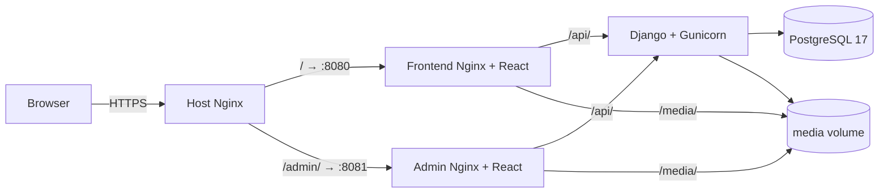

# Totanga

Public information portal and staff administration console for **Bibliothèque Totanga** (Kinshasa). Visitors browse the catalogue, announcements, publications, and events without an account. Library staff manage content through a separate React admin app backed by a Django REST API and PostgreSQL.

## 🌐 Live Demo

| Surface | URL |
| --- | --- |
| Public site | [https://bibtotanga.com](https://bibtotanga.com) |
| Staff administration | [https://bibtotanga.com/admin/](https://bibtotanga.com/admin/) |

## 📌 About

Totanga replaces scattered paper and spreadsheet workflows with a single web portal:

- a **public site** for readers (search, discover, contact the library);
- a **staff console** for day-to-day content and catalogue work;
- a **Django API** that enforces permissions, validation, and data rules.

There are **no reader accounts**, loans, reservations, or favorites. Books are **archived**, never deleted. Acquisition prices and the import register stay off the public API.

## ✨ Features

### Public site

- Home page with library branding, hero image, announcements, and visitor reviews
- Catalogue search and category browsing; book detail with copies, call numbers (cotes), and availability
- Announcements, publications, and events (list + detail)
- About page and static pages (rules, FAQ, legal, privacy, terms)
- Contact / visitor messages and short public reviews (create only)
- Light / dark / system theme preference
- Optional Google Maps Embed for library location
- Anonymous traffic measurement (no stored IP, no third-party trackers)

### Staff administration

- Session login with role-based menu and server-side permission checks
- Dashboard with live catalogue and content figures
- Catalogue: books, authors, publishers, categories, copies (codes / Dewey-style cotes)
- Content: announcements, publications, events (draft / published / archived)
- Staff accounts: list, create (auto-generated password), view, admin password reset
- Roles & permissions matrix for the three staff groups (persisted on the server)
- Library settings (identity, contact, hours, maps, theme tokens, logo / hero)
- Visitor message inbox and action journal
- Site traffic statistics (admin / break-glass roles)
- Import pipeline for the real catalogue register (`REPERTOIRE` / CSV under `data/import`)

## 🏗️ Architecture

Totanga is a **multi-container** application. In production, the **host Nginx** terminates HTTPS and routes traffic to Docker services bound to `127.0.0.1`.



| Layer | Responsibility |
| --- | --- |
| `frontend/` | Public SPA (Vite + React), production Nginx proxies `/api/` and serves `/media/` |
| `admin/` | Staff SPA (separate origin path `/admin/`), `noindex`, same API proxy pattern |
| `backend/` | Django 5 + DRF: public read APIs, staff `/api/gestion/` APIs, media processing |
| `db` | PostgreSQL 17 (`unaccent`, `pg_trgm` for French search) |
| Host Nginx | TLS, routing public vs admin (see `deploy/nginx-admin-hote.snippet.conf`) |

Public API prefixes include `/api/catalogue/`, `/api/annonces/`, `/api/evenements/`, `/api/publications/`, `/api/bibliotheque/`, `/api/messages/`, `/api/visites/`. Staff APIs live under `/api/gestion/`. Health check: `/api/sante/`.

## 🛠️ Tech Stack

| Technology | Role |
| --- | --- |
| Python 3.13, Django 5.2, Django REST Framework | Backend API and domain logic |
| django-cors-headers, django-filter, Pillow, Gunicorn, psycopg | CORS, filtering, images, WSGI, PostgreSQL driver |
| React 19, React Router 7, Vite 7, Tailwind CSS 4, Lucide | Public and admin UIs |
| PostgreSQL 17 | Primary database |
| Docker Compose | Local and production orchestration |
| Nginx (in-container + host) | Static assets, API reverse proxy, HTTPS edge |
| GitHub Actions | CI only (tests + builds; **no** auto-deploy) |

## 🔐 Security

Implemented in code and documented in [`SECURITE.md`](SECURITE.md):

- **No reader accounts**; staff session auth with CSRF-enforced API calls
- **HttpOnly session cookie**; CSRF cookie read by the admin SPA and sent on mutating requests
- **Role groups**: librarian, editor, administrator (+ break-glass superuser without a group)
- **Server-side permissions** on every staff endpoint (UI hide is not enough)
- **Login lockout**: 5 failures → 15 minutes; same response if the account does not exist
- **Session limits**: 30 minutes idle, 10 hours absolute maximum
- **Production**: `DEBUG=False`, Django admin disabled, secure cookies, HTTPS redirect, HSTS, `X-Frame-Options: DENY`, `nosniff`, referrer `same-origin`
- **CORS** allow-list only (`CORS_ALLOW_ALL_ORIGINS` stays false)
- **Secrets** only in `.env` (never committed); `.env.example` is a template without real secrets
- **Passwords**: Django validators; staff passwords generated server-side (create / admin reset), shown once, never logged
- **Uploads**: JPG / PNG / WebP, 5 MB max, resized; no book PDF upload
- **Rich HTML** sanitized on the server before save
- **Public writes** limited to visitor messages and short reviews; contact email / WhatsApp never returned to the public API
- **Rate limiting** on login, catalogue/content reads, visitor messages, and visit beacons
- **Books cannot be deleted** (archive only); last administrator cannot be deactivated or removed
- **Anonymous analytics**: daily fingerprint (not stored as IP); robots ignored; detail purge after 90 days

Items still marked **À faire** in `SECURITE.md` (for example full CSP rollout, Postgres app role without superuser, automated backups) are **not** claimed here.

## 🚀 Local Development

Requirements: Docker and Docker Compose. Nothing needs to be installed on the host beyond that.

1. Copy the environment template and set local secrets:

```powershell
copy .env.example .env
```

Use the **development** host / CORS block from `.env.example` (localhost ports `8000`, `5173`, `5174`). Never commit `.env`.

2. Start the stack:

```powershell
docker compose up --build -d
```

On startup the backend waits for PostgreSQL, runs migrations, syncs roles, creates the daily admin if `DJANGO_SUPERUSER_*` is set, and imports the register when the catalogue is empty.

| Service | URL |
| --- | --- |
| Public site | http://localhost:5173/ |
| Staff admin | http://localhost:5174/ |
| API | http://localhost:8000/ |
| Django `/admin/` | Available in development only |

Source folders are bind-mounted; edits reload the corresponding service.

```powershell
docker compose logs -f backend
docker compose stop
```

## 🚢 Production & Deployment

Production uses [`docker-compose.production.yml`](docker-compose.production.yml):

- `DJANGO_SETTINGS_MODULE=config.settings.production`
- Services bound to `127.0.0.1` (`8080` public, `8081` admin, `8000` API)
- PostgreSQL **not** published outside Docker
- Shared `media_data` volume; container Nginx serves `/media/`

**CI** ([`.github/workflows/ci.yml`](.github/workflows/ci.yml)): Django tests, frontend tests/build, admin tests/build on PRs and pushes to `main`. **No continuous deployment** — GitHub Actions never SSHs to the VPS.

**Manual deploy** on the VPS (see [`docs/deploiement.md`](docs/deploiement.md) and [`deploy/deploy.sh`](deploy/deploy.sh)):

```bash
./deploy/deploy.sh <commit-sha>
```

The script checks out the revision, builds images, recreates containers (volumes kept), waits for `/api/sante/`, and rolls back on failure. Host Nginx must proxy `/admin/` to `127.0.0.1:8081/` (trailing slash required) using the snippet in `deploy/nginx-admin-hote.snippet.conf`.

## 🤖 AI-Assisted Development

Tools such as **Cursor** were used as development assistants to speed up exploration, implementation, UI work, debugging, refactoring, tests, and documentation.

Architecture decisions, domain rules, security choices, and final validation remain under the project author’s responsibility. The AI did not own the product; it assisted delivery.

## 👨‍💻 My Role

As the author of this repository I designed and built the system end to end:

- Domain model for a Francophone library catalogue (books, copies, Dewey-style codes, archive-not-delete)
- Public and staff product surfaces as two separate React applications
- Django REST API with explicit public vs gestion boundaries
- Staff authentication, roles, CSRF session model, and audit journal
- Docker Compose for development and production, plus host Nginx integration
- Security baseline documented and tracked in `SECURITE.md`
- CI pipeline and a deliberate **manual-only** production deploy path
- Real register import path and operational docs under `docs/`

## 📁 Project Structure

```text
totanga/
├── admin/                 # Staff React app (Vite) + production Nginx
├── frontend/              # Public React app (Vite) + production Nginx
├── backend/               # Django project
│   ├── apps/
│   │   ├── accounts/      # Session, staff users, roles, journal
│   │   ├── catalog/       # Books, authors, publishers, categories, copies, import
│   │   ├── announcements/ # Library announcements
│   │   ├── events/        # Events
│   │   ├── posts/         # Publications
│   │   ├── library_info/  # Library settings, theme, maps
│   │   ├── visitor_messages/
│   │   ├── analytics/     # Anonymous traffic stats
│   │   └── common/        # Shared helpers (e.g. health)
│   └── config/settings/   # development vs production
├── data/import/           # Catalogue register files for import
├── deploy/                # Manual deploy script, Nginx snippet, Postgres init
├── docs/                  # Deployment, database notes, task tracking
├── docker-compose.yml
├── docker-compose.production.yml
├── SECURITE.md            # Security rules and checklist
└── .github/workflows/ci.yml
```

Further reading: [`docs/deploiement.md`](docs/deploiement.md), [`docs/base-de-donnees.md`](docs/base-de-donnees.md), [`SECURITE.md`](SECURITE.md).
