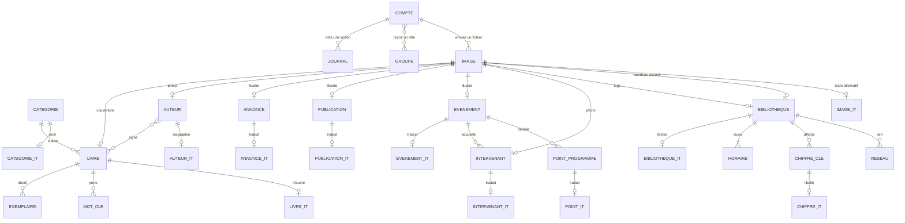

# Base de données

Ce document décrit les données de Totanga. Les décisions du 10 novembre 2026, ci-dessous, l'emportent sur les propositions plus anciennes de ce fichier, en particulier les tables de traduction italienne et les champs qui y étaient marqués obligatoires.

## Décisions validées

1. Le site et l'administration restent en français seulement. L'italien est reporté : aucune table de traduction, aucun sélecteur de langue, aucun réglage de recherche italien, aucun préfixe de langue dans les adresses. Les nouveaux textes d'interface vont dans un fichier de textes central.
2. Un livre exige un titre, au moins un auteur et une catégorie. L'année, le résumé, la couverture, l'éditeur, l'ISBN et le nombre de pages sont facultatifs. Sans couverture, le site montre la couverture de remplacement. Sans résumé, la section est masquée. L'année n'est contrôlée (1000 à 2100) que si elle est renseignée.
3. La langue de l'ouvrage ajoute l'italien (`it`) et Autre (`other`) à la liste déjà en place. Ce n'est pas la langue du site.
4. L'état d'un livre est un seul champ : brouillon, publié ou archivé. Un livre ne se supprime jamais, même par un accès direct à la base.
5. Un message de visiteur aura un statut (nouveau, traité) et une date de traitement, avec une purge des messages traités après 12 mois. Cette partie est prévue à la phase 5.
6. Les horaires auront une seule plage par jour. Ils sont prévus à la phase 4.
7. Le programme d'un événement est un seul texte long, un point par ligne. C'est ainsi qu'il est enregistré depuis la phase 2. Pas de table de points.
8. Un réseau social est choisi dans une liste fermée : Facebook, X, YouTube, LinkedIn, Instagram, WhatsApp. Une image ne se supprime pas tant qu'une fiche l'utilise. Les réseaux sont prévus à la phase 4. La table Image et ce verrou commencent avec les couvertures, en phase 1.
9. L'écran « Rôles et permissions » est en lecture seule dans cette version. Il sera figé à la phase 5. Il n'écrit pas les droits du serveur.
10. Les pages fixes (règlement, FAQ, mentions légales, confidentialité, conditions) restent hors de la base. La page de confidentialité est à écrire avant la mise en ligne. Voir `docs/taches.md`.
11. Pas de comptes lecteurs, de prêts, de favoris, de réservations, de compteur de vues ni de notifications.
12. Le répertoire réel est recopié tel quel dans la table Registre, puis le catalogue est construit à partir de ce registre. Le prix d'acquisition et le registre ne sortent jamais dans l'API publique. La cote n'est pas unique. Le numéro d'inventaire l'est. Une catégorie a au plus une classe parente : filtrer la classe inclut ses sous-classes.

La phase 1 construit le catalogue : état du livre, champs facultatifs, ISBN unique seulement s'il est renseigné, mots-clés en lignes, image commune pour la couverture, recherche en français (accents et fautes de frappe), verrou de suppression.

La phase 2 construit les annonces et les événements. Une annonce a une catégorie fermée, une case Important et des dates. Un événement a un type fermé, un programme en texte et de zéro à cinq intervenants. Ni l'un ni l'autre ne se supprime : on les archive.

Le schéma plus bas a été dessiné avant ces décisions. Les cadres « IT », la table des points de programme et la seconde plage horaire ne sont pas à créer.

## 1. Schéma des relations

Le français est porté par la fiche elle-même. Les cadres « IT » du dessin ne sont pas retenus.

Les messages des visiteurs ne sont reliés à aucune fiche : ce sont des envois, pas un contenu du site.

Un futur module de prêts n'a pas de table ici. Il s'accrochera à `EXEMPLAIRE` par son identifiant, sans refaire le catalogue.

## 2. Les tables

Les types sont ceux de PostgreSQL, tels que Django les écrit. « Obligatoire » veut dire que la base refuse une fiche incomplète.

Les dates qui représentent un instant (publication, début d'un événement, envoi d'un message) sont stockées en temps universel et affichées à l'heure de Kinshasa. Les horaires d'ouverture sont une exception : ce sont des heures murales, voir la fiche Bibliothèque.

### Compte du personnel (`accounts_user`)

Rôle : une personne qui travaille à la bibliothèque. Pas de compte lecteur.

Déjà en place. On n'ajoute pas de téléphone, d'adresse personnelle ni de photo de profil.

| Champ | Type | Obligatoire | Contraintes |
| --- | --- | --- | --- |
| identifiant (`username`) | texte, 150 | oui | unique, lettres, chiffres et `. @ + - _` |
| mot de passe | empreinte | oui | jamais en clair, jamais dans le journal, jamais renvoyé par une liste |
| prénom, nom | texte, 150 | non | le nom affiché est « prénom nom », sinon l'identifiant |
| adresse électronique | texte, 254 | non | réservée au compte, absente des listes du personnel |
| actif | oui / non | oui | un compte inactif ne se connecte pas |
| personnel technique (`is_staff`) | oui / non | oui | faux pour le travail quotidien |
| dépannage (`is_superuser`) | oui / non | oui | hors des trois rôles, pas créé par l'écran |
| dernière connexion, date d'arrivée | instant | la date d'arrivée oui | affichées à Kinshasa |

Lien : plusieurs comptes peuvent partager un groupe. Les groupes existants sont `administrateur`, `bibliothecaire`, `redacteur`. Leurs droits sont ceux de Django (`auth_group`, `auth_permission`). On ne crée pas une deuxième table de rôles. L'écran « Rôles et permissions » qui coche des cases sans les enregistrer sur le serveur ne devient pas une table.

### Journal des actions (`accounts_staffaction`)

Rôle : qui a fait quoi, sur quel objet, quand.

Déjà en place. On ne lui ajoute aucun champ.

| Champ | Type | Obligatoire | Contraintes |
| --- | --- | --- | --- |
| personne | lien vers Compte | non | si le compte disparaît, la ligne reste, sans nom |
| action | texte, 40 | oui | un code court : connexion, création de compte, etc. |
| type d'objet | texte, 80 | non | par exemple `accounts.User` ou `catalog.Book` |
| identifiant d'objet | texte, 64 | non | l'identifiant de la fiche, pas son contenu |
| date | instant | oui | |

Interdit dans cette table : mot de passe, clé, adresse électronique, adresse IP, corps d'un message, texte d'une publication.

### Auteur (`catalog_author`)

Rôle : une personne ou un collectif qui signe un livre. Le nom n'est pas traduit.

Déjà en place. La photo deviendra un lien vers Image, dans une étape à part, pour ne pas casser les fichiers déjà enregistrés.

| Champ | Type | Obligatoire | Contraintes |
| --- | --- | --- | --- |
| nom | texte, 300 | oui | non traduit |
| biographie | texte long | non | français ; l'italien est dans Auteur IT |
| photo | fichier, puis lien vers Image | non | JPG, PNG ou WebP, 5 Mo |

Lien : un auteur peut signer plusieurs livres, un livre peut avoir plusieurs auteurs. La table de liaison existe déjà.

Contrainte à ajouter : un auteur relié à au moins un livre ne peut pas être supprimé. Aujourd'hui l'API le refuse ; la base ne le garantit pas encore.

### Auteur IT

Rôle : biographie italienne facultative.

| Champ | Type | Obligatoire | Contraintes |
| --- | --- | --- | --- |
| auteur | lien | oui | un seul italien par auteur |
| biographie | texte long | oui si la ligne existe | |

### Catégorie du catalogue (`catalog_category`)

Rôle : une classe (Roman, Sciences sociales) ou une sous-classe rangée sous une classe. Le livre est rangé dans la sous-classe lorsqu'elle existe, sinon dans la classe. Filtrer une classe inclut ses sous-classes. Deux sous-classes de classes différentes peuvent porter le même nom. Une sous-classe ne contient pas d'autre sous-classe.

| Champ | Type | Obligatoire | Contraintes |
| --- | --- | --- | --- |
| nom | texte, 120 | oui | unique dans une même classe ; deux classes ne portent pas le même nom |
| classe (`parent`) | lien vers une catégorie | non | vide pour une classe ; une sous-classe ne peut pas servir de classe |
| adresse (`slug`) | texte, 255 | oui | unique, générée depuis le nom |
| description | texte long | non | français |

Lien : une catégorie classe plusieurs livres. Déjà protégée : on ne peut pas la supprimer tant qu'un livre la cite.

### Catégorie IT

| Champ | Type | Obligatoire | Contraintes |
| --- | --- | --- | --- |
| catégorie | lien | oui | un seul italien par catégorie |
| nom | texte, 120 | oui | unique parmi les noms italiens |
| description | texte long | non | |

### Livre (`catalog_book`)

Rôle : la notice bibliographique. Pas l'objet qu'on tient en main.

Déjà en place : titre, auteurs, catégorie, année, résumé, couverture, langue de l'ouvrage, éditeur, ISBN, nombre de pages, mots-clés, deux cases « publié » et « archivé ».

Adaptation proposée : remplacer les deux cases par un seul état. Le nombre de pages et les mots-clés restent. Le résumé français reste sur la fiche. Le titre n'est pas traduit.

| Champ | Type | Obligatoire | Contraintes |
| --- | --- | --- | --- |
| titre | texte, 400 | oui | non traduit |
| adresse (`slug`) | texte, 255 | oui | unique, générée depuis le titre |
| catégorie | lien | oui | |
| année de publication | nombre entier | oui | entre 1000 et 2100, dans la base |
| résumé | texte long | oui | français |
| couverture | fichier, puis lien vers Image | oui aujourd'hui | JPG, PNG ou WebP, 5 Mo |
| langue de l'ouvrage | texte, 8 | oui | `fr`, `en`, `ln`, `kg`, `lua`, `sw` — ce n'est pas la langue du site |
| éditeur | lien vers Éditeur | non | rempli depuis la colonne « Editeur » du répertoire à l'import |
| ISBN | texte, 20 | non | unique seulement s'il est renseigné ; vide devient « rien » plutôt que deux chaînes vides |
| nombre de pages | nombre entier | non | de 1 à 20 000 |
| état | texte | oui | `brouillon`, `publie`, `archive` |
| créé le, modifié le | instant | oui | |
| importé le | instant | non | posé par l'import ; une modification du personnel le dépasse et protège la fiche |

Liens : auteurs, exemplaires, mots-clés, traduction du résumé.

Contraintes à ajouter dans la base :

- une seule valeur d'ISBN lorsqu'elle est renseignée, après avoir retiré les tirets ;
- l'année entre 1000 et 2100 (PostgreSQL n'accepte pas « année courante » dans une règle fixe, parce que la date du jour change) ;
- interdiction de supprimer la ligne. Aujourd'hui seul le programme le refuse. Un livre sans exemplaire pourrait encore être effacé par un accès direct. Un verrou de base comblera ce trou.

Correspondance avec les données actuelles : archivé devient `archive` ; publié faux devient `brouillon` ; le reste devient `publie`. L'API actuelle parle encore des deux cases : cette étape devra les mettre à jour en même temps, sinon l'administration des livres casse.

Le public ne voit que `publie`. « Disponible » sur une carte n'est pas un champ : c'est vrai lorsqu'au moins un exemplaire a le statut disponible.

### Livre IT

| Champ | Type | Obligatoire | Contraintes |
| --- | --- | --- | --- |
| livre | lien | oui | un seul italien par livre |
| résumé | texte long | oui si la ligne existe | le titre n'y figure pas |

### Mot-clé

Rôle : les mots saisis sur la notice, pour la recherche. Ils ne sont pas traduits.

Aujourd'hui ils sont une liste dans un seul champ (`keywords`). On la remplace par une ligne par mot, ce qui permet un index et évite les doublons. L'écran continuera d'afficher une liste.

| Champ | Type | Obligatoire | Contraintes |
| --- | --- | --- | --- |
| livre | lien | oui | |
| libellé | texte, 200 | oui | unique pour un même livre ; une cellule « SOUS-DIVISION 1 » devient un mot-clé, sans découpage |

### Exemplaire (`catalog_copy`)

Rôle : un objet physique. Le statut et l'emplacement sont ici, pas sur le livre.

Déjà en place. On ne le relie pas encore à un prêt.

| Champ | Type | Obligatoire | Contraintes |
| --- | --- | --- | --- |
| livre | lien | oui | supprimer le livre est déjà refusé tant qu'un exemplaire existe |
| numéro d'inventaire | texte, 32 | non | unique ; colonne « N.  e. » du répertoire |
| cote | texte, 80 | oui | non unique ; calculée depuis `code1`, `code2`, `Dewey` |
| code1, code2, code3, code4 | texte, 40 | non | colonnes du répertoire ; saisies dans le formulaire admin |
| Dewey | texte, 40 | non | colonne « Dewey » ; entre dans la cote |
| fonds | texte, 32 | non | colonne « F.N. » |
| cote secondaire | texte, 40 | non | calculée depuis `code3` et `code4` |
| prix d'acquisition | décimal | non | interne ; absent de l'API publique ; 0 signifie inconnu |
| rayon | texte, 80 | non | |
| étagère | texte, 80 | non | |
| statut | texte, 20 | oui | `available`, `borrowed`, `reserved`, `in_repair`, `lost` |
| date d'acquisition | date | non | |
| importé le, modifié le | instant | le second oui | une modification du personnel protège l'exemplaire lors d'un nouvel import |

Le public, sur une carte, ne voit pas ces statuts un par un. Il voit Disponible ou Indisponible, calculé. Le détail (y compris Emprunté) n'apparaît que dans l'onglet des exemplaires. Le prix d'acquisition n'y figure pas.

Ces statuts restent saisis par le personnel tant qu'il n'y a pas de prêts. Le jour où les prêts existeront, ils citeront l'identifiant de l'exemplaire. Rien dans ce schéma ne l'empêche. On ne crée pas la table des prêts, ni des réservations, ni des favoris, ni un compteur de vues.

### Registre (`catalog_registerrow`)

Rôle : miroir exact du fichier `data/import/repertoire.csv`. Une ligne du fichier, rien de converti, rien de nettoyé, y compris la ligne de test `99999 / ABC`. Le catalogue est construit ensuite à partir de ce registre. Le registre n'est pas dans l'API publique. L'administration l'affiche en lecture seule sur la fiche d'un exemplaire, sous le titre « Ligne du registre d'origine ».

| Champ | Type | Obligatoire | Contraintes |
| --- | --- | --- | --- |
| ligne d'origine | entier | oui | unique, numéro de ligne du fichier |
| statut d'import | texte | oui | `importée`, `ignorée`, `anomalie` |
| exemplaire | lien | non | l'exemplaire créé à partir de cette ligne, s'il y en a un |
| les 18 colonnes du fichier | texte | non | mêmes noms : « N.  e. », « F.N. », Auteur, Titre, Editeur, code1, code2, code3, code4, Dewey, « Date publ. », Prix, CLASSE, SOUS-CLASSE, SOUS-DIVISION 1 à 3, Resumé |

### Image

Rôle : un fichier réutilisable (couverture, photo, illustration, logo).

Nouvelle table. Les fichiers déjà posés sur l'auteur et le livre restent en place jusqu'à l'étape qui les déplace.

| Champ | Type | Obligatoire | Contraintes |
| --- | --- | --- | --- |
| fichier | chemin | oui | JPG, PNG ou WebP ; pas de SVG (un SVG peut contenir un script) |
| taille | nombre entier | oui | 5 Mo maximum, contrôlé aussi par la base |
| envoyé par | lien vers Compte | non | si le compte disparaît, l'image reste |
| envoyé le | instant | oui | |
| largeur, hauteur | nombres | non | informatifs |

Le texte alternatif français est sur cette fiche (obligatoire). L'italien est dans Image IT. Une image peut illustrer plusieurs contenus, ou un seul, selon le lien posé par l'annonce, la publication, l'événement, le livre, l'auteur, l'intervenant ou la bibliothèque.

### Annonce

Rôle : un avis affiché au public pendant une période.

| Champ | Type | Obligatoire | Contraintes |
| --- | --- | --- | --- |
| adresse | texte, 255 | oui | unique, générée depuis le titre français |
| catégorie | texte | oui | `informations`, `acquisitions`, `horaires`, `maintenance` |
| important | oui / non | oui | plusieurs annonces peuvent être importantes |
| image | lien vers Image | non | |
| état | texte | oui | `brouillon`, `publie`, `archive` |
| date de publication | instant | oui | temps universel |
| date d'effet | date | non | jour de Kinshasa, sans heure |
| fin d'affichage | date | non | si elle est posée, elle est au plus tôt le jour de publication |

Textes français sur la fiche : titre (obligatoire), corps (obligatoire). Italien dans Annonce IT (titre et corps obligatoires si la ligne existe).

Le public ne voit une annonce que si elle est publiée, que la date de publication est atteinte, et que la fin d'affichage n'est pas passée. « À la une » de la page d'accueil n'est pas un champ : c'est l'annonce importante la plus récente, sinon la plus récente.

La maquette visuelle de l'administration montrait d'autres types (Règlement, Sondage, Appel à contribution) et une étoile « épinglée ». Ils ne sont pas prévus. La liste fermée validée et la case Important suffisent. Plusieurs annonces peuvent être importantes en même temps ; il n'y a pas d'épingle unique.

### Publication

Rôle : un article de la bibliothèque (recommandation, conseil, vie de la bibliothèque).

| Champ | Type | Obligatoire | Contraintes |
| --- | --- | --- | --- |
| adresse | texte, 255 | oui | unique, depuis le titre français |
| catégorie | texte | oui | `Culture`, `Actualité`, `Conseils`, `Événement`, `Technologie` |
| signature | texte, 120 | oui | texte libre, valeur de départ « Équipe Totanga » ; ce n'est pas le compte qui a cliqué |
| à la une | oui / non | oui | une seule publication peut être vraie en même temps |
| image | lien vers Image | non | |
| état | texte | oui | `brouillon`, `publie`, `archive` |
| date de publication | instant | oui | |
| résumé | texte, 250 | oui | français, 250 caractères |
| contenu | texte long | oui | voir le choix de format plus bas |

Italien dans Publication IT : titre, résumé, contenu. La signature et la catégorie ne sont pas traduites dans la base. Les libellés de catégorie vivent dans l'interface, parce que la liste est fermée.

Le compte qui crée ou modifie la publication n'est pas affiché. Il est noté dans le journal, sans le texte de l'article. La suppression depuis l'administration efface définitivement la fiche (comme pour les annonces).

### Événement

Rôle : une séance datée, sur place.

| Champ | Type | Obligatoire | Contraintes |
| --- | --- | --- | --- |
| adresse | texte, 255 | oui | unique |
| type | texte | oui | `conference`, `atelier`, `rencontre`, `salon`, `exposition`, `lecture` |
| début | instant | oui | |
| fin | instant | oui | strictement après le début |
| lieu | texte, 200 | oui | non traduit (nom de salle) |
| image | lien vers Image | non | |
| public visé | texte, 200 | non | français |
| nombre de places | nombre entier | non | 0 ou plus ; vide si on ne l'affiche pas |
| lien d'inscription | texte | non | uniquement `http://` ou `https://`, sinon rien |
| état | texte | oui | `brouillon`, `publie`, `archive` |

Textes français : titre, résumé. Italien dans Événement IT.

« À venir », « En cours » et « Passé » ne sont pas enregistrés. On les calcule en comparant début et fin à l'heure de Kinshasa. Un événement publié mais passé reste visible, avec l'état calculé Passé.

Le nombre d'inscrits de la maquette n'est pas prévu : il n'y a pas d'inscription dans la base, seulement un lien vers une page extérieure.

### Intervenant

Rôle : une personne présentée pour un événement. De 0 à 5.

| Champ | Type | Obligatoire | Contraintes |
| --- | --- | --- | --- |
| événement | lien | oui | au plus 5 lignes, verrou de base |
| nom | texte, 200 | oui | non traduit |
| ordre | nombre, 1 à 5 | oui | unique pour un même événement |
| photo | lien vers Image | non | |
| titre | texte, 200 | non | français, par exemple « Professeure » |

Le titre italien est dans Intervenant IT. Le nom ne l'est pas.

### Point de programme

Rôle : une puce du programme, dans l'ordre.

| Champ | Type | Obligatoire | Contraintes |
| --- | --- | --- | --- |
| événement | lien | oui | |
| ordre | nombre | oui | unique pour un même événement, à partir de 1 |
| texte | texte, 300 | oui | français |

L'italien est dans Point IT.

### Bibliothèque

Rôle : l'unique fiche de l'établissement. Une seule ligne, imposée par la base (identifiant fixé à 1).

| Champ | Type | Obligatoire | Contraintes |
| --- | --- | --- | --- |
| nom | texte, 200 | oui | non traduit |
| logo | lien vers Image | non | |
| image du bandeau d'accueil | lien vers Image | non | JPG, PNG ou WebP, 5 Mo max. ; à défaut le site public garde l'image statique |
| adresse | texte, 300 | oui | |
| ville | texte, 120 | oui | |
| téléphone | texte, 40 | oui | |
| adresse électronique de contact | texte, 254 | oui | affichée au public, ce n'est pas l'adresse d'un compte |
| présentation, histoire, mission, vision, valeurs, services | textes longs | non | français |
| texte du pied de page | texte long | non | français |
| localisation Google Maps | texte, 500 | non | adresse libre ou lien `http://` / `https://` ; carte intégrée via Google Maps Embed |
| latitude, longitude | nombres | non | les deux ensemble, ou aucun ; récupérées depuis un lien Maps quand possible |

Italien dans Bibliothèque IT, pour les textes longs seulement. Le nom, l'adresse, le téléphone et l'adresse de contact ne sont pas traduits.

### Horaire

Rôle : une ligne par jour. Sept lignes, une par jour, reliées à la fiche unique.

| Champ | Type | Obligatoire | Contraintes |
| --- | --- | --- | --- |
| jour | nombre, 1 à 7 | oui | 1 = lundi … 7 = dimanche ; unique |
| fermé | oui / non | oui | |
| ouverture, fermeture | heure | oui si le jour n'est pas fermé | la fermeture est après l'ouverture |

Ce sont des heures de Kinshasa, pas des instants universels. « 9 h » doit rester 9 h à l'écran, même si le serveur est ailleurs. Le mot « Lundi » ou « Lunedì » n'est pas en base : l'interface le traduit à partir du numéro du jour.

Une note facultative par jour (français sur la ligne, italien dans une petite table) couvre un cas comme « fermé les jours fériés » si on en a besoin. Le libellé du jour, lui, n'est pas saisi.

### Chiffre clé

Rôle : un nombre saisi par le personnel pour la page À propos. Il ne remplace pas les vrais comptes du catalogue.

| Champ | Type | Obligatoire | Contraintes |
| --- | --- | --- | --- |
| ordre | nombre | oui | |
| valeur | texte, 40 | oui | saisi, par exemple « 12 000 » ; pas calculé |
| libellé | texte, 120 | oui | français |

Libellé italien dans Chiffre IT. S'il n'y a aucun chiffre, le site n'affiche pas ce bloc. Les comptes réels (nombre de livres publiés, d'événements publiés) restent calculés à part.

### Réseau

Rôle : un lien vers une page de la bibliothèque (Facebook, etc.).

| Champ | Type | Obligatoire | Contraintes |
| --- | --- | --- | --- |
| nom | texte, 40 | oui | par exemple Facebook |
| adresse | texte | oui | `http://` ou `https://` seulement |

### Message d'un visiteur (`visitor_messages_visitormessage`)

| Champ | Type | Obligatoire | Contraintes |
| --- | --- | --- | --- |
| type (`kind`) | texte, 20 | oui | `contact` (message au personnel) ou `avis` (témoignage public) |
| nom | texte, 80 | oui | |
| adresse électronique | texte, 254 | non | obligatoire seulement pour un contact (ou WhatsApp) ; jamais renvoyée au public |
| WhatsApp | texte, 40 | non | obligatoire seulement pour un contact (ou e-mail) |
| sujet | texte, 20 | oui | contact : question générale, horaires, catalogue, événement, autre ; avis : `avis` |
| message | texte, 1 000 | oui | pas de HTML ; avis public limité à 280 caractères |
| lu | oui / non | oui | défaut non ; réservé au personnel |
| envoyé le | instant | oui | |

L’API publique liste uniquement les `avis`. Les messages `contact` restent réservés au personnel.

### Fréquentation (`analytics_*`)

Mesure anonyme du site public, lue depuis le menu **Statistiques** (permission `analytics.view_sitestat`).

Événement détaillé (`analytics_trafficevent`) : jour, empreinte quotidienne (SHA-256, jamais l'IP), chemin, type de page, livre/catégorie éventuels, terme de recherche nettoyé, appareil, origine, instant. Purge après 90 jours.

Compteurs agrégés conservés (`analytics_dailytraffic`) : visiteurs, visites (séjours de 30 minutes), pages vues ; plus pages, livres, catégories, recherches, appareils, origines.

Aucune adresse IP, aucun cookie de suivi, aucun compte lecteur.

## 3. Correspondance avec les écrans

« Calculé » signifie que la base ne stocke pas cette valeur : on la obtient en comptant ou en comparant des dates.

### Site public

| Écran | Information | Où elle est |
| --- | --- | --- |
| En-tête | logo, nom | Bibliothèque, logo |
| Accueil (bandeau) | image du bandeau | Bibliothèque, image |
| En-tête | recherche | aucun enregistrement ; elle filtre le catalogue |
| Accueil | annonce mise en avant | calculé : annonce publiée, importante de préférence, la plus récente |
| Accueil | autres annonces | Annonce, titre, catégorie, date |
| Accueil | livres et pastille Disponible / Indisponible | Livre publié ; pastille calculée depuis les exemplaires |
| Accueil | nombre de livres d'une catégorie | calculé |
| Accueil | publication montrée | Publication dont « à la une » est vrai ; sinon la plus récente publiée |
| Accueil | événements à venir | calculé : publiés, fin dans le futur |
| Accueil | adresse, téléphone, horaires, réseaux | Bibliothèque, Horaire, Réseau |
| Catalogue | liste, filtres, nombre de résultats | Livre, Auteur, Catégorie ; le nombre est calculé |
| Catalogue | « 1 024 livres » ou « des milliers » | pas prévu : c'était un chiffre de maquette |
| Fiche livre | titre, auteurs, année, résumé, éditeur, ISBN, pages, langue, mots-clés | Livre, Auteur, Mot-clé |
| Fiche livre | Disponible / Indisponible | calculé |
| Fiche livre | titre, auteur, éditeur, date publ., classe ; exemplaires avec N. e., F.N., code1–code4, Dewey, prix | Livre et Exemplaire (aligné sur REPERTOIRE) |
| Fiche livre | Réserver, Favoris | pas prévu : pas de compte lecteur |
| Annonces | titre, catégorie, important, dates, image, texte | Annonce |
| Publications | titre, catégorie, signature, résumé, contenu, à la une | Publication |
| Événements | type, dates, lieu, places, programme, intervenants | Événement et tables liées |
| Événements | bouton S'inscrire | lien d'inscription, seulement s'il est http ou https |
| Événements | nombre d'inscrits | pas prévu |
| À propos | présentation, histoire, mission, vision, valeurs, services | Bibliothèque |
| À propos | chiffres saisis | Chiffre clé, seulement s'il en existe |
| À propos | nombres de livres, annonces, publications, événements | calculés sur les fiches publiées |
| À propos | photos décoratives du bandeau | fichiers du site, pas une table, tant qu'elles ne sont pas du contenu saisi |
| Pied de page | texte, contacts, horaires | Bibliothèque, Horaire, Réseau |
| Pied de page | phrase « exemples fictifs » | pas un champ durable ; les données de démonstration portent déjà leur propre mention |
| Contact | formulaire | Message d'un visiteur |
| Règlement, FAQ, mentions, confidentialité, conditions | pages fixes | pas en base dans cette version : ce ne sont pas des contenus validés comme saisissables |
| Partage Facebook, X, LinkedIn, WhatsApp | boutons | calculé dans le navigateur à partir de l'adresse de la page ; rien n'est enregistré |

### Administration

| Écran | Information | Où elle est |
| --- | --- | --- |
| Connexion | identifiant, mot de passe | Compte ; le mot de passe n'est pas stocké en clair |
| Tableau de bord | nombres de livres, exemplaires, annonces, événements | calculés |
| Tableau de bord | 12 846 livres, graphiques et pourcentages de la maquette | pas prévu : ce ne sont pas les données réelles |
| Livres, auteurs, catégories | champs des formulaires ; classe et sous-classe ; ligne du registre en lecture seule | Livre, Auteur, Catégorie, Exemplaire, Mot-clé, Image, Registre |
| Annonces | formulaire | Annonce ; pas les types supplémentaires de la maquette visuelle |
| Publications | formulaire, rédacteur affiché | signature en texte libre ; le compte réel est seulement dans le journal |
| Publications | contenu riche | champ `contenu`, format laissé ouvert |
| Événements | formulaire simple déjà dessiné, plus programme et intervenants | Événement, Point de programme, Intervenant |
| Utilisateurs | identifiant, nom, rôle, date d'arrivée, actif | Compte et Groupe |
| Utilisateurs | adresse électronique dans la liste | pas renvoyée, même si le compte en a une |
| Utilisateurs | rôle Membre, 482 membres | pas prévu : pas de compte lecteur |
| Nouveau compte | mot de passe généré | écrit dans l'empreinte du Compte ; montré une fois ; absent du journal |
| Rôles et permissions | cases cochées | pas une table à nous ; droits Django déjà en place |
| Paramètres, onglet Général | nom, logo, bandeau d'accueil, adresse, téléphone, contact, présentation | Bibliothèque et Image |
| Paramètres | slogan, thème, mode sombre, fuseau, format de date, éléments par page | pas en base : le fuseau est Kinshasa pour tout le monde, le reste est un choix d'écran |
| Paramètres | mode maintenance | pas en base dans cette version : couper le site public est une décision à part |
| Paramètres | favicon | pas dans la fiche validée |
| Mon profil | nom, identifiant, fonction, arrivée, dernière connexion | Compte |
| Mon profil | adresse électronique affichée, téléphone, adresse personnelle, portrait | pas prévus : l'adresse du compte n'est pas montrée, le reste n'est pas nécessaire |
| Préférences | langue d'écran, thème, densité, alertes | pas en base : elles ne survivent pas au rechargement tant qu'on n'a pas décidé de les garder |
| Notifications | liste, pastille, compteurs | pas de table : il n'y a pas encore de flux à enregistrer ; le journal pourra les nourrir plus tard |
| Journal | onglet Actions | Journal des actions |
| Journal | onglet Statistiques | Fréquentation (anonyme) |
| Changer le mot de passe | nouveau mot de passe | empreinte du Compte, quand l'écran sera réellement branché |
| Aide | texte d'aide | pas une table |

## 4. Choix de conception

### Traduction

La méthode n'était pas encore écrite. Trois options :

1. Un paquet spécialisé. Il ajoute une dépendance, ce qui demande un accord, et il cache le schéma.
2. Deux colonnes sur chaque fiche (`resume_fr`, `resume_it`). C'est simple au début, puis lourd dès qu'un texte s'ajoute.
3. Le français sur la fiche, obligatoire. L'italien dans une table fille, absente s'il n'y a pas de traduction. Le site retombe sur le français.

Recommandation : l'option 3. Pas de paquet. Le titre d'un livre et le nom d'une personne ne sont jamais dans la table italienne. Une seule adresse de page, la même dans les deux langues. La langue choisie par le visiteur viendra au moment de l'interface, pas d'un deuxième identifiant.

### Format du contenu d'une publication

Options : texte long, document JSON, ou HTML dès maintenant.

Le contenu est un HTML déjà nettoyé côté serveur (même famille de balises que l'éditeur). Le site public l'affiche via SafeHtml.

### Une seule publication à la une

Options : laisser plusieurs étoiles, ou l'interdire.

Recommandation : l'interdire dans la base. Un index n'accepte qu'une seule ligne avec « à la une » vrai. Mettre une autre publication à la une retire la précédente dans la même opération.

### État d'un livre

Options : garder les deux cases actuelles, ou un seul champ à trois valeurs.

Recommandation : un seul champ, identique aux annonces, publications et événements. L'adaptation est risquée pour l'écran des livres déjà branché ; elle se fait dans une étape dédiée, avec la correspondance décrite plus haut.

### Images

Options : laisser chaque fiche porter son fichier, ou une table commune.

Recommandation : la table commune, parce que le même fichier doit pouvoir servir à une annonce et à une publication, avec un texte alternatif traduisible. On ne déplace les couvertures et les photos déjà en ligne que dans une étape séparée, après avoir vérifié que les adresses publiques suivent.

### Exemplaires et prêts futurs

Options : figer le statut, ou préparer une table de prêts vide.

Recommandation : pas de table vide. Le statut reste saisi à la main. L'identifiant de l'exemplaire est stable, donc un prêt futur pourra le citer. Quand ce module existera, il deviendra la source du statut, pour éviter qu'une saisie manuelle contredise un prêt.

### Types d'événements

Options : liste fermée dans la base, ou table que le personnel allonge.

Recommandation : liste fermée (conférence, atelier, rencontre littéraire, salon, exposition, lecture). Ajouter un type sera une petite évolution. « Etc. » ne devient pas une saisie libre, sinon les filtres se dispersent.

### Horaires

Options : instants universels, ou heures murales.

Recommandation : heures murales de Kinshasa. Un instant universel ferait bouger « 17 h » selon le fuseau du serveur.

### Fenêtre d'affichage d'une annonce

Options : instants, ou dates.

Recommandation : la publication est un instant. L'effet et la fin sont des dates de Kinshasa. Ainsi une annonce prévue jusqu'au 31 décembre reste visible toute la journée à Kinshasa, et pas seulement jusqu'à minuit universel.

### Recherche

À activer dans PostgreSQL, une fois, avant les index de recherche :

- l'extension `unaccent`, pour que « é » et « e » se retrouvent ;
- l'extension `pg_trgm`, pour tolérer une faute de frappe ;
- une fonction stable autour de `unaccent`, parce que PostgreSQL refuse d'indexer la fonction d'origine ;
- les configurations de texte `french` et `italian`, livrées avec PostgreSQL, à vérifier dans l'image du conteneur.

Index prévus : titre et nom d'auteur pour les fautes de frappe ; vecteur de recherche français sur le titre, le résumé et les mots-clés ; vecteur italien sur les résumés traduits. On ne lance pas ces index avant que les textes existent.

Créer une extension demande un droit large sur la base. Le compte de l'application ne devrait pas être super-utilisateur en production. L'activation se fait donc avec un compte de maintenance, pas dans le code du site.

### Ce qui est sensible

On n'enregistre que ceci de personnel :

- le message d'un visiteur : nom, adresse électronique, texte ;
- le compte du personnel : identifiant, nom, empreinte du mot de passe, adresse électronique si elle a été posée à la création du compte Django.

L'adresse d'un visiteur et le corps de son message ne sortent pas vers le site public et n'entrent pas dans le journal. L'adresse d'un compte du personnel ne figure pas dans la liste des comptes. Le prix d'acquisition des exemplaires et le registre d'import ne sortent pas dans l'API publique. Aucune adresse IP en base. La fréquentation du site est anonyme (empreinte quotidienne + agrégats ; détails 90 jours). Pas de téléphone ni d'adresse de domicile du personnel.

Le contact public de la bibliothèque (téléphone, adresse, courriel de la fiche) est un contenu affiché, pas une donnée de compte.

## 5. Plan de construction

Chaque étape est petite. Aucune ne commence avant l'accord sur ce document. Aucune migration n'est écrite ici.

1. **Accord sur ce plan.** Risque : aucun. On ne touche pas à la base.
2. **Extensions de recherche.** Risque : le compte courant de la base n'a peut-être pas le droit de les créer. On le vérifie avant. Le site actuel ne change pas.
3. **État du livre, ISBN vide, verrou de suppression.** Risque : l'administration des livres et ses tests utilisent encore « publié » et « archivé ». Il faudra les adapter dans la même étape. Des ISBN déjà en double ou des chaînes vides peuvent empêcher l'unicité : on les contrôle avant de poser la règle.
4. **Protection des auteurs reliés à un livre, dans la base.** Risque : un test ou un écran qui supprimait encore un auteur lié recevra un refus. C'est le comportement voulu.
5. **Mots-clés en lignes.** Risque : l'API des livres renvoie aujourd'hui une liste. Elle doit continuer de le faire, même si le stockage change.
6. **Table Image, sans encore déplacer les fichiers.** Risque : faible si les anciennes colonnes restent. Le déplacement des couvertures est une étape plus tard, avec vérification des adresses `/media/`.
7. **Fiche bibliothèque, horaires, chiffres, réseaux, textes italiens.** Risque : le site public lit encore des exemples locaux. Créer les tables ne le change pas. Le brancher sera une autre étape, pour ne pas remplacer les exemples par une fiche vide.
8. **Annonces, puis publications, puis événements**, chacun avec sa traduction et ses règles (fin après début, un seul « à la une », lien http, cinq intervenants). Risque : les écrans d'administration actuels sont en mémoire et s'effacent au rechargement. On les branche seulement quand la table correspondante existe. Le site public, qui lit encore des exemples, ne doit pas montrer un brouillon.
9. **Index de recherche.** Risque : faible tant que le catalogue est petit. Si l'extension manque, l'étape s'arrête sans modifier les fiches.
10. **Lecture publique.** Risque : montrer un brouillon ou une annonce hors dates. Les tests devront prouver que seuls les contenus publiés et encore affichables sortent.

Les prêts, les comptes lecteurs, les favoris, les réservations, les notifications et les préférences d'écran ne sont dans aucune de ces étapes.
